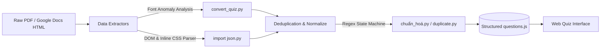

# 🎓 UniQuiz Hub — Hệ Thống Ôn Tập Trắc Nghiệm & Pipeline Xử Lý Đề Thi

[](https://opensource.org/licenses/MIT)
[](https://www.python.org/)
[](https://developer.mozilla.org/en-US/docs/Web/JavaScript)
[](https://html.spec.whatwg.org/)
[](https://www.w3.org/TR/CSS/)

> **UniQuiz Hub** là bộ giải pháp toàn diện phục vụ việc ôn luyện thi trắc nghiệm đại học, bao gồm các ứng dụng làm bài thi tương tác trên nền tảng Web (zero-setup) và hệ thống kịch bản ETL/NLP tự động hóa trích xuất dữ liệu câu hỏi từ tài liệu thô (PDF, Google Docs HTML).

---

## 📌 Mục Lục

- [Tổng Quan Dự Án](#-tổng-quan-dự-án)
- [Các Chuyên Đề Môn Học](#-các-chuyên-đề-môn-học)
- [Tính Năng Nổi Bật](#-tính-năng-nổi-bật)
- [Kiến Trúc & Pipeline Xử Lý Dữ Liệu](#-kiến-trúc--pipeline-xử-lý-dữ-liệu)
- [Cấu Trúc Thư Mục](#-cấu-trúc-thư-mục)
- [Hướng Dẫn Sử Dụng](#-hướng-dẫn-sử-dụng)
  - [1. Dành Cho Người Dùng Ôn Tập](#1-dành-cho-người-dùng-ôn-tập)
  - [2. Dành Cho Nhà Phát Triển / ETL Data](#2-dành-cho-nhà-phát-triển--etl-data)
- [Hướng Dẫn Deploy GitHub Pages](#-hướng-dẫn-deploy-github-pages)
- [Đóng Góp & Phát Triển](#-đóng-góp--phát-triển)
- [Giấy Phép (License)](#-giấy-phép-license)

---

## 📖 Tổng Quan Dự Án

Việc ôn tập các môn đại cương (Triết học, Quản trị học,...) thường gặp nhiều khó khăn do số lượng câu hỏi trắc nghiệm đồ sộ, các file tài liệu PDF scan hoặc tài liệu thô thiếu công cụ tự kiểm tra. **UniQuiz Hub** giải quyết triệt để vấn đề này với hai phân hệ chính:

1. **Web Quiz Engines**: Các trang web làm bài trắc nghiệm với giao diện hiện đại, chạy hoàn toàn ở phía client (không cần cài đặt backend hay database), hỗ trợ xáo trộn đề, tính điểm và giải thích chi tiết.
2. **Data Extraction & Transformation Tools**: Bộ công cụ Python ứng dụng các kỹ thuật xử lý ngôn ngữ và phân tích thuộc tính Typography (Font Anomaly Detection) để tự động nhận dạng câu hỏi và đáp án đúng từ các định dạng tài liệu thô.

---

## 📚 Các Chuyên Đề Môn Học

### 1. Triết Học Mác - Lênin
- **Ngân hàng câu hỏi**: Hơn **350+ câu hỏi** chuẩn bám sát đề cương học phần.
- **Giao diện**: Phong cách *Classic Editorial / Vintage* nhẹ nhàng (Google Fonts `Playfair Display` & `Lora`), dịu mắt cho các buổi ôn tập kéo dài.
- **Tập tin chính**: `quiz_for_anyone.html`, `quiz_for_Như.html`, `questions.js`.

### 2. Quản Trị Học Đại Cương (QTHĐC)
- **Ngân hàng câu hỏi**: Đầy đủ các chủ đề từ Lập kế hoạch, Cơ cấu tổ chức, Lãnh đạo đến Kiểm soát. Có tích hợp giải thích chuyên sâu và tham chiếu slide bài giảng (`slideRef`).
- **Giao diện**:
  - `QTHĐC/quiz_QT.html`: Phong cách **Cyber Dark Mode Glassmorphism** hiện đại.
  - `QTHĐC/quiz_QTHĐC.html`: Phong cách thanh lịch, tối giản.
  - `QTHĐC/index.html`: Chế độ tra cứu nhanh toàn bộ ngân hàng câu hỏi.
- **Tập tin chính**: `QTHĐC/question_QTHĐC.js`, `QTHĐC/data.js`.

---

## ✨ Tính Năng Nổi Bật

- 🎯 **Trực quan & Tương tác cao**: Làm bài trắc nghiệm một chạm, hiển thị kết quả trực quan ngay sau khi nộp bài.
- 🔀 **Smart Shuffle (Xáo trộn thông minh)**: Tự động đảo ngẫu nhiên thứ tự câu hỏi và phương án trả lời, loại bỏ thói quen học vẹt theo vị trí A/B/C/D.
- 💡 **Giải thích chi tiết (Instant Explanations)**: Cung cấp lập luận, trích dẫn lý thuyết và chương bài giảng liên quan cho từng phương án.
- ⏱️ **Áp lực phòng thi**: Tích hợp đồng hồ đếm ngược giúp người học rèn luyện phản xạ thời gian.
- 🚀 **Zero Dependency Client**: Không cần cài đặt Node.js hay web server, chỉ cần click đúp chuột vào file HTML là có thể bắt đầu làm bài.
- 📱 **Responsive Design**: Tối ưu hiển thị trên cả máy tính để bàn, laptop, tablet và điện thoại di động.

---

## 🧠 Kiến Trúc & Pipeline Xử Lý Dữ Liệu

Dự án tích hợp các thuật toán trích xuất dữ liệu thông minh trong thư mục gốc và thư mục `QTHĐC/`:



1. **Font Anomaly Detection (`convert_quiz.py`, `convert.py`)**:
   - Sử dụng `pdfplumber` để trích xuất từng dòng văn bản kèm thông tin ký tự (characters metadata).
   - Áp dụng thuật toán tần suất (`Counter`) trên danh sách font của các phương án: nếu một phương án có font khác biệt (in nghiêng, đổi họ font, v.v.), hệ thống tự động suy diễn đó là đáp án chính xác mà không cần nhập thủ công.
2. **HTML / Google Docs Parser (`QTHĐC/import json.py`)**:
   - Sử dụng `BeautifulSoup` duyệt cây DOM của tài liệu HTML được xuất từ Google Docs (`Quntrhc.html`).
   - Phân tích inline CSS (`font-weight: 700`, mã màu hex) để định danh các đáp án đúng và chuyển hóa cấu trúc thành JSON.
3. **Regex State Machine & Data Sanitizer (`script.py`, `chuẩn_hoá.py`, `duplicate.py`)**:
   - Máy trạng thái Regex phân tích phân đoạn câu hỏi (`Câu \d+`) và các nhãn phương án (`[a-d][\.\)]`).
   - Tự động re-index định danh ID liên tục từ 1 đến N và phát hiện các câu hỏi trùng lặp trong cơ sở dữ liệu.

---

## 📂 Cấu Trúc Thư Mục

```text
.
├── .gitignore                     # Cấu hình bỏ qua tệp tạm, virtualenv, cache hệ thống
├── LICENSE                        # Giấy phép mã nguồn mở MIT
├── README.md                      # Tài liệu kỹ thuật dự án
├── requirements.txt               # Danh sách thư viện Python phục vụ pipeline ETL
├── HƯỚNG DẪN SỬ DỤNG FILE.txt    # Hướng dẫn nhanh cho người học
│
├── quiz_for_anyone.html           # Ứng dụng Web trắc nghiệm Triết học (Bản tiêu chuẩn)
├── quiz_for_Như.html              # Ứng dụng Web trắc nghiệm Triết học (Bản thiết kế nâng cao)
├── questions.js                   # Ngân hàng 350+ câu hỏi Triết học Mác - Lênin
│
├── convert_quiz.py                # Pipeline bóc tách đề thi từ PDF bằng Font Anomaly
├── script.py                      # Pipeline chuẩn hóa văn bản & bóc tách máy trạng thái
├── debug_pdf.py                   # Script phân tích metadata PDF (hỗ trợ debug cấu trúc file)
│
└── QTHĐC/                         # Phân hệ Quản trị học đại cương
    ├── quiz_QT.html               # Web Quiz QTHĐC giao diện Dark Mode Glassmorphism
    ├── quiz_QTHĐC.html            # Web Quiz QTHĐC giao diện Classic Light
    ├── index.html                 # Giao diện tra cứu danh mục ngân hàng câu hỏi
    ├── like.html                  # Cyber visual interactive module
    ├── Quntrhc.html               # Dữ liệu nguồn Google Docs HTML
    ├── question_QTHĐC.js          # Ngân hàng câu hỏi QTHĐC (kèm giải thích & slide)
    ├── questions.js               # Dữ liệu câu hỏi QTHĐC rút gọn
    ├── data.js                    # Mock data & metadata
    ├── convert.py                 # Tool trích xuất PDF cho QTHĐC
    ├── import json.py             # Parser HTML sang JSON/JS bằng BeautifulSoup
    ├── chuẩn_hoá.py               # Script chuẩn hóa & đánh lại ID câu hỏi
    ├── duplicate.py               # Thuật toán phát hiện câu hỏi trùng lặp
    ├── clean.js                   # Script dọn dẹp dữ liệu JavaScript
    └── migrate_data.js            # Script chuyển đổi schema dữ liệu
```

---

## 🚀 Hướng Dẫn Sử Dụng

### 1. Dành Cho Người Dùng Ôn Tập

Không cần cài đặt bất kỳ phần mềm nào:
1. Clone hoặc tải toàn bộ repository về máy tính:
   ```bash
   git clone https://github.com/dangminhquandk/Quiz-Triet-QTHDC.git
   ```
2. Mở thư mục vừa tải:
   - **Ôn Triết học**: Mở tệp [`quiz_for_anyone.html`](file:///Users/quandkh/Downloads/Quiz_Triết/quiz_for_anyone.html) hoặc [`quiz_for_Như.html`](file:///Users/quandkh/Downloads/Quiz_Triết/quiz_for_Như.html) bằng bất kỳ trình duyệt nào (Chrome, Edge, Safari, Firefox).
   - **Ôn Quản trị học**: Vào thư mục `QTHĐC/` và mở [`QTHĐC/quiz_QT.html`](file:///Users/quandkh/Downloads/Quiz_Triết/QTHĐC/quiz_QT.html).
3. Làm bài, theo dõi thời gian và nhấn **Nộp bài / Xem điểm** để xem thống kê kết quả cùng đáp án đúng.

### 2. Dành Cho Nhà Phát Triển / ETL Data

Nếu bạn muốn trích xuất dữ liệu từ các file PDF hoặc tài liệu HTML mới:

1. **Khởi tạo môi trường ảo Python**:
   ```bash
   python3 -m venv .venv
   source .venv/bin/activate  # Trên macOS/Linux
   # .venv\Scripts\activate   # Trên Windows
   ```

2. **Cài đặt các gói phụ thuộc**:
   ```bash
   pip install -r requirements.txt
   ```

3. **Chạy kịch bản trích xuất**:
   - Trích xuất từ PDF qua anomaly font:
     ```bash
     python convert_quiz.py
     ```
   - Chuyển đổi file HTML từ Google Docs sang JS:
     ```bash
     cd QTHĐC
     python "import json.py"
     ```
   - Chuẩn hóa lại ID câu hỏi:
     ```bash
     python "chuẩn_hoá.py"
     ```

---

## 🌐 Hướng Dẫn Deploy GitHub Pages

Bạn có thể đưa bộ ôn tập này lên mạng internet hoàn toàn miễn phí thông qua GitHub Pages:

1. Truy cập vào kho lưu trữ trên GitHub: `https://github.com/dangminhquandk/Quiz-Triet-QTHDC`.
2. Vào **Settings** > **Pages** (ở cột menu bên trái).
3. Tại mục **Build and deployment** > **Branch**:
   - Chọn nhánh: `main`.
   - Chọn thư mục: `/ (root)`.
   - Nhấn **Save**.
4. Sau 1-2 phút, bạn sẽ nhận được đường link trực tuyến:
   - Trang ôn Triết học: `https://dangminhquandk.github.io/Quiz-Triet-QTHDC/quiz_for_anyone.html`
   - Trang ôn QTHĐC: `https://dangminhquandk.github.io/Quiz-Triet-QTHDC/QTHĐC/quiz_QT.html`

---

## 🤝 Đóng Góp & Phát Triển

Mọi đóng góp nhằm hoàn thiện ngân hàng câu hỏi hoặc tối ưu hóa thuật toán trích xuất đều được chào đón:
1. Fork dự án.
2. Tạo nhánh tính năng mới (`git checkout -b feature/ThemMonHocMoi`).
3. Commit thay đổi (`git commit -m 'Thêm ngân hàng đề môn Kinh tế chính trị'`).
4. Push lên nhánh vừa tạo (`git push origin feature/ThemMonHocMoi`).
5. Tạo một **Pull Request**.

---

## 📄 Giấy Phép (License)

Dự án được phân phối dưới giấy phép **MIT License**. Chi tiết xem tại tệp [`LICENSE`](LICENSE).

---

<p align="center">
  Phát triển với sự tâm huyết nhằm hỗ trợ cộng đồng sinh viên ôn luyện hiệu quả 🚀
</p>
